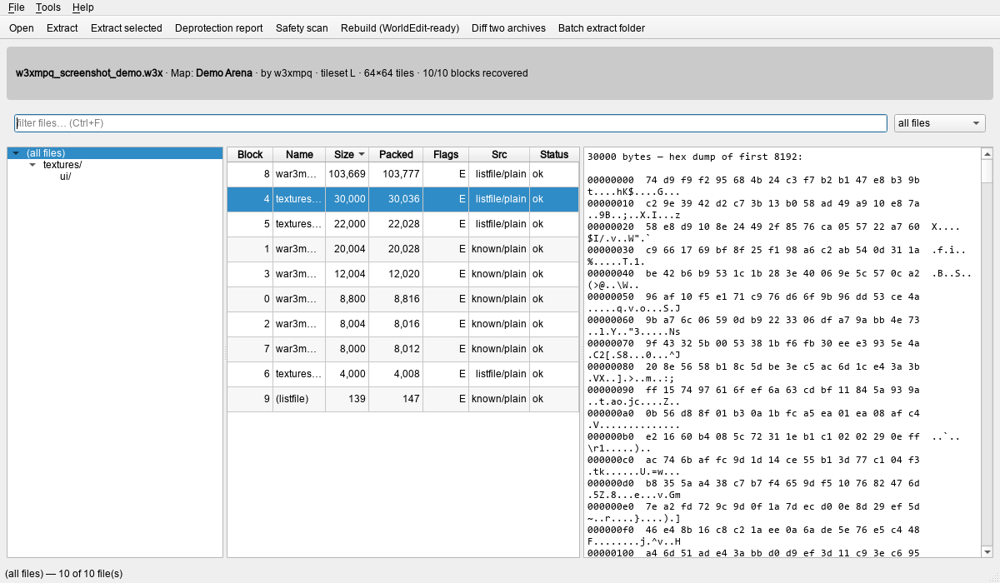
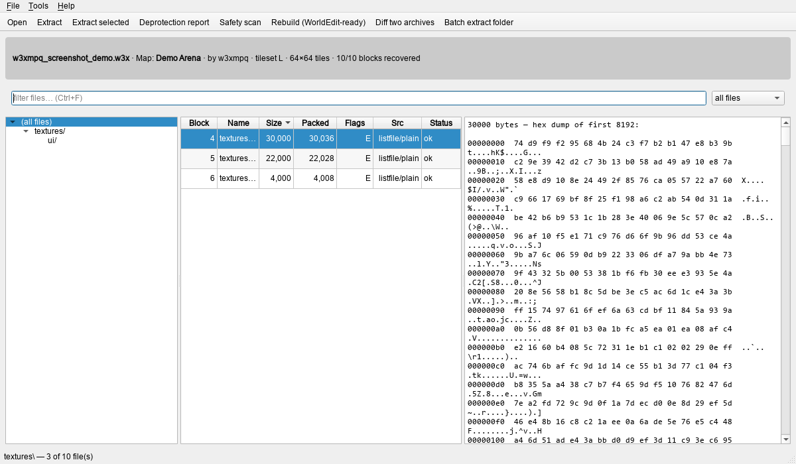
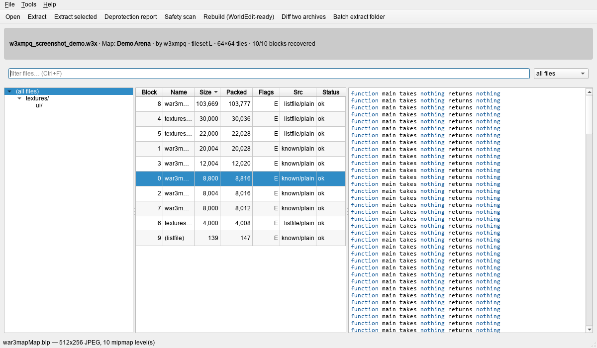
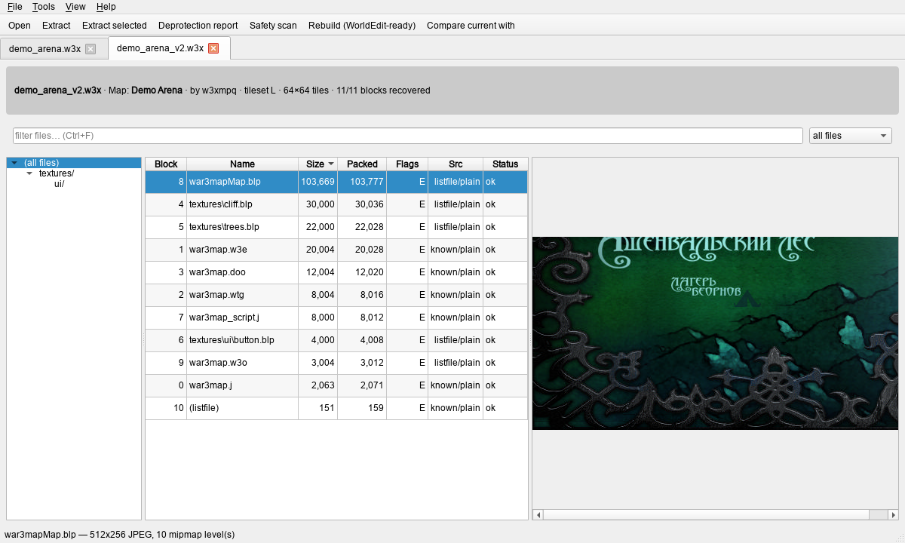
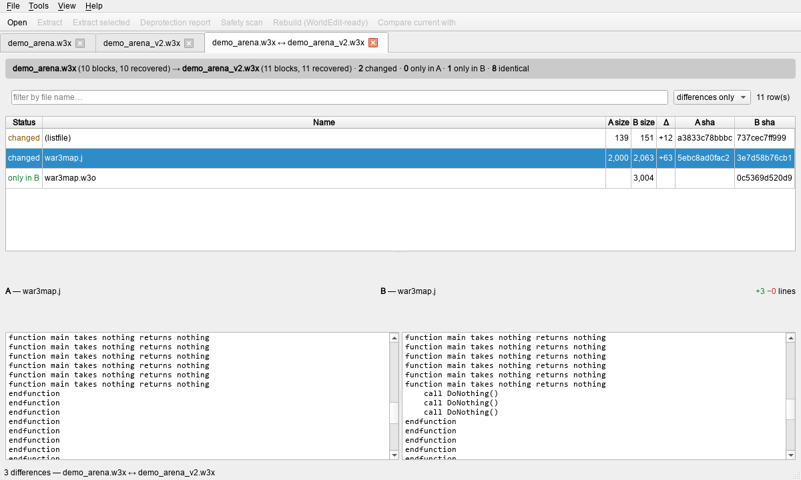
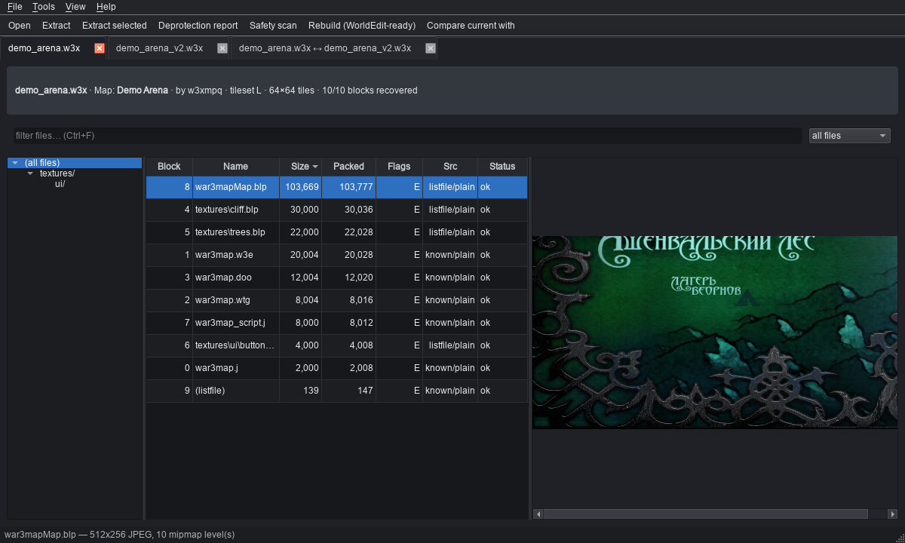

# w3xmpq

> Open any MPQ. Crack any map. Export its static models. No listfile, no keys, no editor required.

**w3xmpq** is a pure-Python tool that opens `.mpq` archives and Warcraft III
`.w3x`/`.w3m` maps, recovers every file — **including encrypted/protected
ones** — via a known-plaintext attack on the MPQ sector offset table, and
lets you list, extract, diff and batch-process them from a professional CLI
or a 7-zip-style GUI. It can also export bounded **static MDX geometry to FBX**
with a machine-readable sidecar for automated asset pipelines.



<details>
<summary>Tree view + hex preview</summary>



</details>

<details>
<summary>Texture preview (.blp) — decoded and rendered inline</summary>


</details>

<details>
<summary>Script preview with JASS syntax highlighting</summary>



</details>

<details>
<summary>Tabs — several archives open at once</summary>



</details>

<details>
<summary>In-app diff — both versions of a file, side by side</summary>



</details>

<details>
<summary>Dark theme</summary>



</details>

```text
$ w3xmpq report "DotA v6.83dAI PMV 1.42 EN.w3x"

Deprotection report — DotA v6.83dAI PMV 1.42 EN.w3x
files: 1297 recovered, 0 failed

[!] Script moved to fallback path (high)
    The main script was found at the game's fallback path
    (Scripts\war3map.j -> extracted as war3map_script.j, 4,164,351 bytes)
    while the canonical war3map.j is absent. World Editor reads only the
    canonical name — this is the classic script-relocation protection.
[!] Authoring files missing (editor-hostile) (high)
    World Editor needs these to open/edit a map: war3map.wtg, war3map.wct,
    war3map.imp, war3map.w3t, war3map.w3q, war3map.w3u, war3mapUnits.doo
[*] Decoy (listfile) (warning)
    The (listfile) is binary junk (43% printable) — a decoy meant to
    confuse naive tools.

Verdict: Script recovered, but World Editor would refuse this map:
re-add the missing authoring files to make it editor-openable.
The extracted war3map_script.j is a ready replacement for the
canonical war3map.j.
```

## Why?

Every existing MPQ tool (Ladik's MPQ Editor, `mpyq`, …) needs a listfile and
fails on encrypted files. w3xmpq needs **neither** — it recovers each file's
encryption key from the data itself. Verified on real protected maps:

| Map | Files recovered | Key failures |
|---|---|---|
| DotA v6.83dAI PMV 1.42 EN | **1297/1297** | 0 |
| MooMoo v3.19b Generation X | **557/559** | 0 (2 unreadable-by-design blocks) |

## Who is it for?

- **Players** — peek inside a map: models, skins, music.
- **Map authors** — recover your own locked/lost source: `report` explains exactly how your map is protected.
- **Modders** — extract assets with proper names into typed folders.
- **Reviewers / admins** — `scan` flags suspicious JASS patterns before you host a map.
- **Researchers** — key forensics, entropy analysis, `--json` everywhere.
- **Archivists** — `batch` over thousands of maps with a CSV index.
- **Developers** — a stable pure-Python MPQ engine (`from w3xmpq import …`).
- **Asset-pipeline agents** — `mdx2fbx` emits deterministic FBX plus a JSON report of counts, hashes and unresolved data.

## Install

```bash
pip install .            # from source
```

Requires Python 3.9+. Zero dependencies for the CLI; the GUI needs
`pip install PySide6`, and converting a texture to PNG from the command
line needs `pip install Pillow` (saving it as `.jpg` does not).
No-Python binaries (CLI **and** GUI) are on the
[releases page](https://github.com/kissanima/w3xmpq/releases).

## GUI (v1.5)

```bash
w3xmpq gui map.w3x       # or download w3xmpq-gui.exe from releases
```

A professional windowed interface built on Qt/PySide6:

- **Tabs** — every archive opens in its own tab (Ctrl+W closes, Ctrl+Tab
  cycles); drop several maps at once and they all open
- **Drag & drop** any `.w3x` / `.w3m` / `.mpq` onto the window
- **Folder tree** (left) — recovered paths shown as a tree; click a folder
  to filter the file table, like a zip browser
- **File table** (middle) — every recovered block with name, sizes, flags
  and status; **click any column to sort**, ctrl/shift-click for
  multi-select, and a **live filter box** (Ctrl+F) to narrow 1000+ blocks
- **Src column** — shows how each file was recovered: `listfile` /
  `known` / `guess` (name) and `crack` / `named` / `plain` (key)
- **Preview pane** (right) — script/text files as text, everything else as
  a hex dump
- **Texture preview** — `.blp` files are decoded and shown as images,
  including the JPEG-flavoured textures Warcraft III 1.22+ uses
- **Static 3D model preview** — a **single click** on an `MDLX`/`.mdx` row
  opens an orbitable, zoomable rest-pose mesh in the preview pane; wireframe,
  reset-view and **Export FBX** buttons sit in the preview header. No
  temporary FBX is created just to preview the model
- **JASS syntax highlighting** — keywords, natives, numbers and comments
  are coloured in script previews
- **Right-click** a file → Preview · Extract selected… · Copy name
- **Map banner** — name, author, tileset, recovery count at a glance
- **Scan progress** with a Cancel button for big maps
- **Find in file** (Ctrl+Shift+F) — search inside a huge script
- **In-app diff** — compare two maps in a tab: files are paired by name,
  so an edited script reads as *changed* (not "added" + "removed"), and
  both versions are shown side by side, scrolled to the first difference
- **Dark theme** (Ctrl+Shift+D) — a real dark palette, remembered between
  sessions
- **Tools** — deprotection report, safety scan, WorldEdit-ready rebuild,
  folder batch extraction — all on background threads so the UI never
  freezes

## Quickstart

```bash
w3xmpq open   map.w3x                    # archive info
w3xmpq list   map.w3x                    # recovered file table
w3xmpq extract map.w3x -o out/           # extract everything
w3xmpq extract map.w3x -f "war3map"      # selective extraction
w3xmpq report  map.w3x                   # deprotection report
w3xmpq scan   map.w3x                    # map safety scan
w3xmpq diff   old.w3x new.w3x            # version comparison
w3xmpq batch  ./maps/ -o out/            # bulk processing
w3xmpq rebuild map.w3x -o fixed.w3x      # WorldEdit-ready copy
w3xmpq blp    texture.blp -o out.png     # decode a Warcraft III texture
w3xmpq objects war3map.w3a               # decode ability/unit/item overrides
w3xmpq mdx2fbx Footman.mdx -o Footman.fbx --json
                                         # static MDX -> FBX + JSON sidecar
w3xmpq mdx2fbx War3.mpq "Units\Human\Footman\Footman.mdx" -o Footman.fbx --json
                                         # same, straight from an MPQ member
```

All commands accept `--json` for machine-readable output. Exit codes:
`0` ok, `1` partial, `2` fatal.

## MDX → FBX for Unity and agents

`mdx2fbx` exports **rest-pose geometry only**: vertices, normals, the first UV
set, texture path references and per-geoset materials. It writes ASCII FBX 7.4,
which Unity's native FBX importer accepts without extra packages. Every run
also writes `<out>.fbx.json` unless `--no-sidecar` is given.

```bash
# Loose file
w3xmpq mdx2fbx Footman.mdx -o Footman.fbx --json

# Directly from an archive; a bare stem resolves to .mdx
w3xmpq mdx2fbx War3.mpq "Units\Human\Footman\Footman.mdx" -o Footman.fbx --json

# Remap BLP references to already-exported PNG files
w3xmpq mdx2fbx Footman.mdx -o Footman.fbx --texture-map textures.json --json
```

`--json` prints the same report that is saved to the sidecar:

| Field | Meaning |
|---|---|
| `input` | `file` or `archive-member`, with the archive/member actually used |
| `source_sha256`, `output.fbx_sha256` | deterministic hashes for caching and verification |
| `model` | geoset/vertex/triangle counts, bounds, material and texture counts |
| `geosets` | per-geoset counts, material id, UV sets and texture slots |
| `texture_map` | normalized path mapping used for this run |
| `limits`, `truncated`, `unresolved` | exactly what was bounded or left out |

Agent-friendly defaults: vertex budget 50,000, index budget 150,000, geoset
budget 128; all three are overridable. Exceeding a limit truncates and sets
`truncated: true` — it never guesses missing geometry. Use `w3xmpq mdx2fbx
--help` for the full contract and copy-paste examples.

In the GUI, selecting a model previews this same geometry directly; the FBX
button above the viewport calls the exporter with the selected archive entry.
The preview is read-only and uses the same vertex/index/geoset limits.

The converter is deliberately conservative. It does **not** apply animation,
skin weights, material/texture animation, shader semantics, particle/light/
ribbon emitters or texture pixels; those remain in `unresolved[]`. Export BLP
textures with `w3xmpq blp` and pass `--texture-map` when a real material is
needed. No screenshot parity with Warcraft III is claimed.

## How the crack works

See [docs/how-it-works.md](docs/how-it-works.md) for the full math. In short:

1. Every encrypted MPQ file starts with its sector offset table, whose first
   DWORD is always `4 * (sectors + 1)` — **known plaintext**.
2. The MPQ cipher's first output word is
   `ct0 ^ p0 = key + 0xEEEEEEEE + T[0x400 + (key & 0xFF)]`, so enumerating
   the 256 table indexes yields self-consistent key candidates.
3. Each candidate is verified by decrypting the whole table and checking it
   is monotonic, starts at `4*(sectors+1)` and ends at the archived size.

No listfile, no filenames, no brute force.

## Deprotection patterns

w3xmpq recognizes the classic "game-lenient, editor-hostile" tricks —
see [docs/deprotection-patterns.md](docs/deprotection-patterns.md).

## Ethics

w3xmpq exists for recovering **your own** locked maps, format study, modding,
and game preservation. Don't use it to steal other people's work. The safety
scan provides evidence for review — it is not a verdict.

## Docs

- [docs/release-notes.md](docs/release-notes.md) — version history and release scope
- [docs/how-it-works.md](docs/how-it-works.md) — the key-recovery math
- [docs/deprotection-patterns.md](docs/deprotection-patterns.md) — protection patterns and what the report says about each
- [docs/blp-format.md](docs/blp-format.md) — how Warcraft III textures really work (including the split JPEG frame header)
- [docs/library-api.md](docs/library-api.md) — the Python API

## Development

```bash
pip install -e .
python -m unittest discover -s tests -v
```

The test suite builds synthetic encrypted MPQ fixtures from scratch —
no copyrighted game data is ever committed.

## Credits

- [mpyq](https://github.com/alanstevens/mpyq) (MIT, © Aku Kotkavuo) — the MPQ
  reading core is vendored and adapted in `src/w3xmpq/core/mpq.py`.
- StormLib documentation — MPQ format constants.
- Ladik's MPQ Editor — inspiration (and the tool that *can't* do this).
- The WC3 modding community (Hive Workshop) — for keeping the format alive.

## License

MIT — see [LICENSE](LICENSE).
